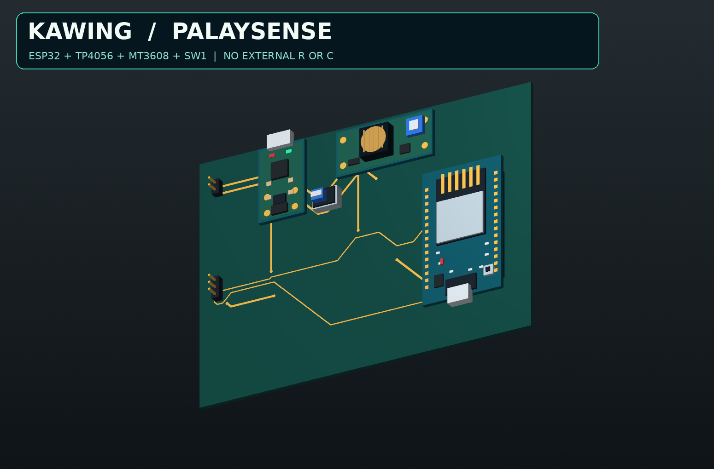
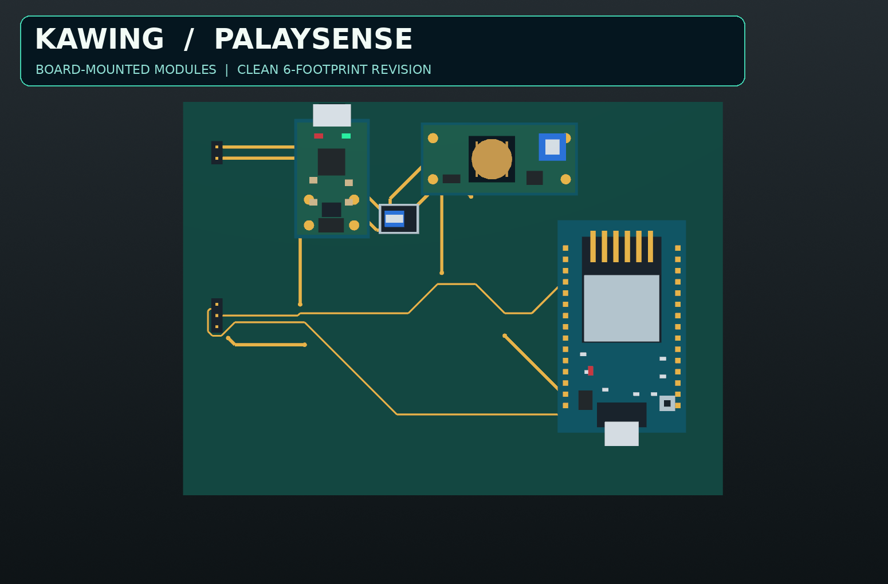
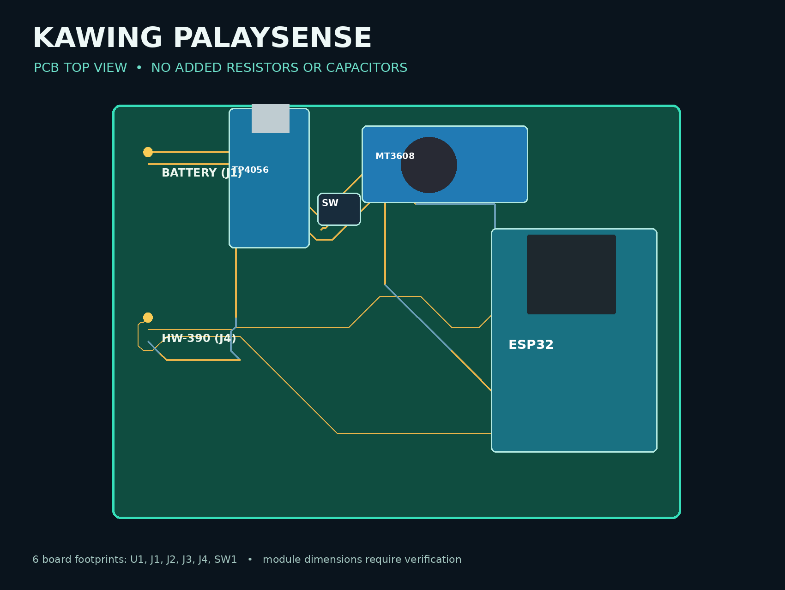
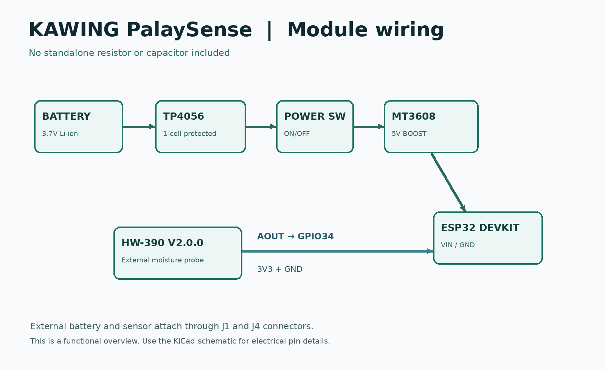

<div align="center">

# KAWING PalaySense

### ESP32-Based Grain Moisture Assessment and IoT Integration

**A hardware prototype for assessing rice-grain moisture and transmitting readings to the KAWING post-harvest coordination platform.**


[Overview](#overview) • [Hardware](#hardware-components) • [PCB Design](#pcb-design--3d-preview) • [Getting Started](#getting-started)

</div>

---

## Overview

**PalaySense** is the grain moisture assessment component of **KAWING (Knowledge-based Agricultural Workflow Integration Network Gateway)**, an IoT-integrated post-harvest coordination platform developed to support rice farmers in **Magalang, Pampanga, Philippines**.

The system utilizes an **ESP32 DevKit V1** and an **HW-390 V2.0.0 capacitive moisture sensor** to estimate rice grain moisture content.

Sensor readings are processed by the ESP32, converted into estimated moisture percentages using an adopted mathematical model, and classified according to predefined moisture thresholds.

Through Wi-Fi connectivity, PalaySense can transmit the processed readings to the KAWING web platform using a REST API.

This repository contains the project's hardware design, electronic schematic, PCB layout, 3D models, and related documentation.

> **Development Status:** Academic hardware prototype. Moisture measurement accuracy and PCB manufacturing readiness require further testing and validation.

---

## PCB Design & 3D Preview

The PalaySense PCB was developed using **KiCad**, with the power management modules and ESP32 mounted on a single carrier board.

### 3D PCB — Isometric View



### 3D PCB — Top View



### PCB Layout



### Wiring Diagram



**Design Features:**

- Integrated ESP32 DevKit V1 mounting
- Onboard TP4056 charging module
- Onboard MT3608 boost converter
- Integrated ON/OFF power switch
- External moisture sensor connector
- External rechargeable battery connection
- Two-layer PCB design
- Editable KiCad schematic and PCB layout
- Custom 3D component models

> The 3D models are illustrative. Actual component dimensions, mounting positions, and PCB clearances must be verified before manufacturing.

---

## Key Features

| Feature | Description |
|---|---|
| Moisture Assessment | Estimates rice grain moisture content using an HW-390 capacitive sensor |
| ESP32 Processing | Processes analog sensor data using a 12-bit ADC |
| ADC Averaging | Averages 20 sensor readings to reduce fluctuations |
| Moisture Classification | Categorizes readings into four moisture conditions |
| Wi-Fi Connectivity | Enables communication with the KAWING platform |
| REST API Integration | Transmits sensor readings as JSON |
| Rechargeable Power | Uses a 3.7V Li-ion battery with a TP4056 charging module |
| Voltage Regulation | Uses an MT3608 boost converter for 5V output |
| PCB Integration | Combines the ESP32 and power modules on one PCB carrier |

---

## Hardware Components

The PalaySense hardware uses the following components:

| Component | Quantity | Purpose |
|---|---|---|
| ESP32 DevKit V1 | 1 | Main microcontroller and Wi-Fi communication |
| HW-390 V2.0.0 Capacitive Sensor | 1 | Analog moisture sensing |
| TP4056 Charging Module | 1 | Rechargeable battery charging and protection, if equipped |
| MT3608 Boost Converter | 1 | Converts battery voltage to regulated 5V |
| 3.7V Li-ion Battery | 1 | Portable power supply |
| ON/OFF Switch | 1 | Controls device power |
| Custom PCB | 1 | Mounts and connects the electronic modules |
| Connectors and Wires | As required | Electrical interconnections |

**Note:** No additional standalone resistors or capacitors were added to the carrier PCB. The existing ESP32, TP4056, and MT3608 modules contain their own internal electronic components.

---

## Electrical Connections

### HW-390 Sensor to ESP32

| HW-390 Pin | ESP32 Pin | Function |
|---|---|---|
| VCC | 3V3 | Sensor power |
| AOUT | GPIO34 | Analog moisture signal |
| GND | GND | Common ground |

### Power Management Connections

| Component | Connection |
|---|---|
| Battery Positive | TP4056 B+ |
| Battery Negative | TP4056 B- |
| TP4056 OUT+ | ON/OFF switch input |
| ON/OFF switch output | MT3608 IN+ |
| TP4056 OUT- | MT3608 IN- |
| MT3608 OUT+ | ESP32 VIN / 5V |
| MT3608 OUT- | ESP32 GND |
| ESP32 3V3 | HW-390 VCC |
| ESP32 GPIO34 | HW-390 AOUT |

### Power Flow

```text
       3.7V Li-ion Battery
                |
                v
       TP4056 Charging Module
                |
                v
          ON/OFF Switch
                |
                v
       MT3608 Boost Converter
                |
                | 5V Output
                v
          ESP32 DevKit V1
                |
                | 3.3V Power
                v
       HW-390 Moisture Sensor
                |
                | Analog Output
                v
           GPIO34 ADC
```

The ESP32 uses its built-in Wi-Fi module to send processed sensor readings to the KAWING REST API.

**Important Safety Notes:**

- Adjust the MT3608 output to 5.0V before connecting the ESP32.
- Verify voltage and polarity with a multimeter.
- Use a suitable protected Li-ion charging arrangement.
- The TP4056 module must support the intended battery protection and output connections.
- Do not bypass battery protection circuitry.
- Confirm the ESP32 board's external power compatibility.

---

## How PalaySense Works

The grain moisture assessment process consists of five main stages.

### 1. Sensor Data Acquisition

The HW-390 capacitive moisture sensor produces an analog voltage that varies according to the sensor's response to the measured material.

The analog output is connected to the ESP32's GPIO34 pin.

### 2. Analog-to-Digital Conversion

The ESP32 uses its 12-bit Analog-to-Digital Converter (ADC) to obtain raw readings.

```cpp
const int SENSOR_PIN = 34;
const int ADC_RESOLUTION = 12;
const int SENSOR_SAMPLES = 20;
```

The ADC produces digital values ranging from 0 to 4095.

The firmware averages 20 readings, with a 10-millisecond delay between samples.

### 3. Moisture Percentage Estimation

The averaged ADC reading is processed using an adopted conversion model based on the work of Putri et al. (2023).

The 12-bit ADC result is first normalized into a 10-bit equivalent.

```text
ADC10 = (ADC12 × 1023) / 4095

CorrectedADC = ADC10 / 1.0054

Moisture (%) = 100 - ((CorrectedADC / 898) × 100)
```

The calculated result is constrained between 0% and 100%.

This formula serves as the prototype's adopted moisture estimation model.

> **Calibration Notice:** The use of a published conversion formula does not establish measurement accuracy for the specific HW-390 sensor. Reference moisture meter comparison and device-specific validation are required.

### 4. Grain Moisture Classification

After calculating the estimated moisture percentage, the system categorizes the result.

| Moisture Content | Classification | Interpretation |
|---|---|---|
| Above 17% | Wet | High moisture level |
| 15% to 17% | Moderate | Intermediate moisture level |
| Above 11% to below 15% | Dry | Lower moisture level |
| 11% and below | Risk of Grain Breakage | Very low moisture level |

These classifications are defined within the KAWING prototype's firmware.

### 5. Data Transmission

After processing the moisture reading, the ESP32 sends the results to the KAWING REST API through Wi-Fi.

The transmitted JSON structure includes:

```json
{
  "deviceId": "YOUR_DEVICE_ID",
  "sensorModel": "HW-390 V2.0.0",
  "rawValue": 2500,
  "calibrated": true,
  "moisturePercentage": 30.00,
  "classification": "Wet"
}
```

The JSON shown above is an illustrative format, not an actual sensor measurement. The `calibrated` field is retained for compatibility with the existing firmware and does not independently verify device calibration.

---

## Firmware Overview

The ESP32 firmware was developed using the Arduino framework.

### Required Libraries

```cpp
#include <WiFi.h>
#include <HTTPClient.h>
```

### Firmware Configuration

| Parameter | Configuration |
|---|---|
| Microcontroller | ESP32 |
| Sensor | HW-390 V2.0.0 |
| Analog Input | GPIO34 |
| ADC Resolution | 12-bit |
| ADC Range | 0–4095 |
| Samples per Reading | 20 |
| Sampling Delay | 10 ms |
| Reading Interval | 5000 ms |
| Wi-Fi Timeout | 20000 ms |
| Communication | HTTP POST |
| Data Format | JSON |

### Sensitive Configuration

The public firmware uses placeholders for private network and server information.

```cpp
const char* WIFI_SSID =
  "YOUR_WIFI_NAME";

const char* WIFI_PASSWORD =
  "YOUR_WIFI_PASSWORD";

const char* KAWING_API_URL =
  "http://YOUR_SERVER:PORT/YOUR_API_ENDPOINT";

const char* KAWING_API_KEY =
  "YOUR_API_KEY";

const char* DEVICE_ID =
  "YOUR_DEVICE_ID";
```

**Security Reminder:** Never upload real Wi-Fi passwords, API keys, or confidential server information to a public repository. Configure these values privately before deployment. Use HTTPS for API communication where supported.

---

## Getting Started

### Requirements

Before opening or testing the project, prepare:

- KiCad PCB design software
- Arduino IDE with ESP32 board support
- ESP32 DevKit V1
- HW-390 V2.0.0 capacitive moisture sensor
- TP4056 charging module
- MT3608 boost converter
- 3.7V rechargeable Li-ion battery
- Multimeter
- USB cable and suitable wiring

### Step 1: Clone the Repository

```bash
git clone https://github.com/LouiseCatala/Kawing-PalaySense.git

cd Kawing-PalaySense
```

### Step 2: Open the KiCad Project

Navigate to:

```text
KAWING_PalaySense_NO_R_C_FIXED_KiCad/
└── KAWING_PalaySense_No_Extra_RC/
```

Open:

```text
KAWING_PalaySense.kicad_pro
```

You can then inspect and edit the schematic and PCB layout.

### Step 3: View the 3D PCB

Inside KiCad:

1. Open the PCB Editor.
2. Select **View → 3D Viewer**.
3. Alternatively, press `Alt + 3`.
4. Enable the display of component 3D models.

Keep the project's custom footprint and 3D model folders together.

If VRML component models do not appear, try opening:

```text
KAWING_PalaySense_STEP_Alternative.kicad_pcb
```

This version provides STEP-based 3D model references.

### Step 4: Prepare the Hardware

1. Verify all power and sensor wiring.
2. Connect the battery through the appropriate TP4056 connections.
3. Set the MT3608 boost converter to 5.0V.
4. Connect the regulated output to the ESP32 VIN/5V input.
5. Connect the HW-390 sensor to GPIO34, 3V3, and GND.

### Step 5: Upload the Firmware

1. Open the PalaySense Arduino `.ino` file.
2. Configure private Wi-Fi and backend credentials.
3. Select the appropriate ESP32 board in Arduino IDE.
4. Select the correct COM port.
5. Compile and upload the sketch.

### Step 6: Monitor Sensor Readings

Open the Arduino Serial Monitor.

Set the baud rate to:

```text
115200
```

The device displays:

- Raw ADC value
- Estimated moisture percentage
- Moisture classification
- Wi-Fi connection status
- HTTP response status

A new sensor assessment is initiated approximately every five seconds, depending on network operations.

---

## Repository Structure

```text
Kawing-PalaySense/
│
├── README.md
│
└── KAWING_PalaySense_NO_R_C_FIXED_KiCad/
    │
    └── KAWING_PalaySense_No_Extra_RC/
        │
        ├── KAWING_PalaySense.kicad_pro
        ├── KAWING_PalaySense.kicad_sch
        ├── KAWING_PalaySense.kicad_pcb
        │
        ├── KAWING_PalaySense_STEP_Alternative.kicad_pcb
        ├── KAWING_PalaySense_No_Extra_RC.step
        │
        ├── KAWING.kicad_sym
        ├── KAWING.pretty/
        ├── KAWING.3dshapes/
        │
        ├── 3D_Assembly/
        │   ├── KAWING_No_Extra_RC_Isometric.png
        │   ├── KAWING_No_Extra_RC_Top.png
        │   └── KAWING_PalaySense_No_Extra_RC.glb
        │
        ├── PCB_Clean_Top_Layout.png
        ├── Wiring_Overview.png
        └── README.md
```

---

## Testing and Validation

The following activities are recommended before finalizing the hardware prototype.

### Sensor Testing

- Test repeatability across multiple sensor readings.
- Compare measurements with a calibrated grain moisture meter.
- Evaluate different grain moisture conditions.
- Document measurement error and calibration results.

### Hardware Testing

- Verify battery charging operation.
- Measure boost converter output voltage.
- Inspect component polarity.
- Verify ESP32 power stability.
- Check sensor signal continuity.

### PCB Validation

- Run KiCad Electrical Rules Check (ERC).
- Run KiCad Design Rules Check (DRC).
- Verify component dimensions and mounting positions.
- Inspect trace widths and copper clearances.
- Confirm that the ESP32 antenna placement is appropriate.

### Connectivity Testing

- Verify Wi-Fi connection.
- Test REST API communication.
- Confirm expected server responses.
- Validate JSON payload handling.
- Verify that records are correctly processed by the KAWING backend.

---

## Project Limitations

PalaySense is currently an academic prototype.

The following limitations must be considered:

1. **Measurement Accuracy:** The adopted conversion model requires device-specific validation using a reference grain moisture instrument.
2. **Mechanical Design:** PCB module footprints and 3D models must be checked against actual components.
3. **Power Management:** The TP4056 module does not necessarily provide proper simultaneous charging and load-sharing functionality.
4. **Network Dependency:** Sending readings to KAWING requires Wi-Fi connectivity and an accessible backend.
5. **Manufacturing Readiness:** Electrical and mechanical checks must be completed before fabricating the PCB.

---

## About KAWING

**KAWING** stands for **Knowledge-based Agricultural Workflow Integration Network Gateway**.

The complete project is titled:

**KAWING: An IoT-Integrated Web-Based Smart Post-Harvest Coordination Platform with Grain Moisture Assessment and Community Access Kiosk for Rice Farmers in Magalang, Pampanga.**

The platform aims to support rice farmers through post-harvest coordination, agricultural service access, information management, and moisture assessment integration.

PalaySense serves as its dedicated IoT grain moisture assessment component.

---

## Technology Stack

| Technology | Application |
|---|---|
| ESP32 | Embedded processing and communication |
| Arduino / C++ | Firmware development |
| HW-390 | Capacitive sensing |
| Wi-Fi | Wireless connectivity |
| REST API | Communication with KAWING |
| JSON | Sensor data transmission |
| KiCad | Electronic schematic and PCB design |
| STEP / VRML | 3D electronic component visualization |

---

## Disclaimer

This repository is intended for academic research, learning, and hardware prototyping.

The moisture estimation model and PCB design should not be considered commercially certified or production-ready without appropriate validation, testing, and safety verification.

---

<div align="center">

### KAWING PalaySense

**Smart Grain Moisture Assessment Through Embedded Systems and IoT**

*Part of the KAWING Smart Post-Harvest Coordination Platform*

Made for academic research and development.

</div>
